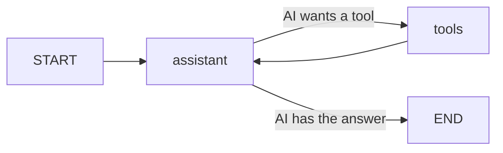

# Khata Assistant — a LangGraph Agent with RAG

**Author:** Trija Shashankar

## The problem
Small shops in Nepal give goods on credit (*udhaaro*) and track it in a paper
khata, on a calculator, or with phone screenshots. Records get lost, totals are
added by hand, and shop rules (credit limits, collection days) live only in the
owner's head.

## What this app does
A shopkeeper types in plain language. The assistant **keeps the ledger** in a
database and **answers questions about the shop's rules** using RAG.

```
You:   What is the credit limit for new customers?
Khata: New customers can take up to Rs 500 on credit. Regular customers up to Rs 2000.
You:   Ram took Rs 2200 of rice on credit
Khata: Saved. Ram owes Rs 2200. Warning: this is over the Rs 2000 credit limit.
You:   Can I give cigarettes on credit?
Khata: No, cigarettes are cash only.
You:   Ram paid 700
Khata: Saved. Ram's remaining balance is Rs 1500.
You:   Who owes me money?
Khata: Ram: Rs 1500. Total outstanding: Rs 1500.
```
*(Example conversation. Exact wording comes from the AI and will vary.)*

## Architecture



The `tools` node holds 5 tools:

| Tool | Type | What it does |
|---|---|---|
| `add_credit` | Ledger (SQLite) | Save goods taken on credit |
| `record_payment` | Ledger (SQLite) | Save a payment, blocks overpaying |
| `get_balance` | Ledger (SQLite) | One customer's balance + recent history |
| `list_all_dues` | Ledger (SQLite) | Everyone who owes money + total |
| `search_shop_rules` | **RAG** | Searches `shop_rules.md` for policy answers |

### The RAG pipeline (`knowledge.py`)
1. **Load** `shop_rules.md` (credit limits, collection days, discounts, cash-only items, hours, returns)
2. **Split** into chunks with `RecursiveCharacterTextSplitter` (splits on headings first)
3. **Embed** each chunk with `FastEmbedEmbeddings` (BAAI/bge-small-en-v1.5, free, runs locally, no API key)
4. **Store** vectors in `InMemoryVectorStore`
5. **Retrieve** the top 3 chunks for a question; the LLM answers only from them

**Fallback:** if the embedding model cannot download (no internet), the app
automatically switches to `BM25Retriever` keyword search, so it still works.

### LangChain / LangGraph concepts used
| Concept | Where | Purpose |
|---|---|---|
| RAG (split, embed, vector store, retriever) | `knowledge.py` | Answer from the shop's own document |
| Tools (`@tool`) | both files | Python functions the AI can call; docstrings tell it when |
| State (`MessagesState`) | `build_graph` | Shared conversation between nodes |
| Nodes | `assistant`, `tools` (`ToolNode`) | LLM thinks / Python runs |
| Conditional edge | `route()` | Go to tools, or finish |
| Loop | `tools -> assistant` | AI reads results; can chain tools (e.g. add credit, then check limit) |
| Memory | `MemorySaver` + `thread_id` | Follow-ups like "how much does *he* owe?" |
| Model abstraction | `get_llm()` | Same graph runs on Groq (Llama 3.3) or xAI Grok |

**Design choice:** the AI never calculates money. Balances come from SQL, and
policy answers come from the retrieved document, which reduces hallucination.

## How to run

```bash
pip install -r requirements.txt
# copy .env.example to .env and paste ONE key (GROQ_API_KEY or XAI_API_KEY)
python khata_agent.py
```

The first run downloads the small embedding model (~70 MB). Type `quit` to
exit. Delete `khata.db` to start with an empty ledger. Edit `shop_rules.md`
to change the shop's policies; the app re-reads it on start.

## Files
- `khata_agent.py` — LangGraph agent, ledger tools, chat loop
- `knowledge.py` — RAG pipeline and the `search_shop_rules` tool
- `shop_rules.md` — the knowledge document
- `requirements.txt`, `.env.example`
